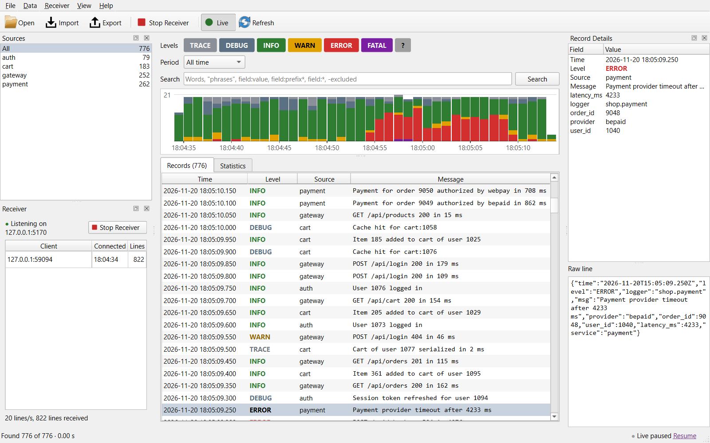
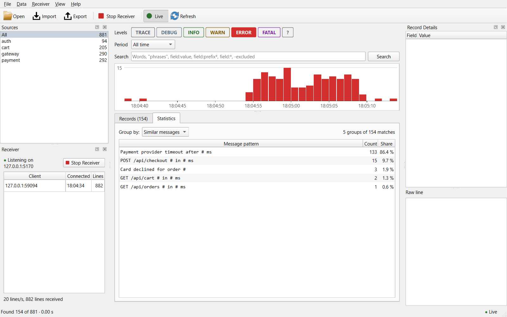
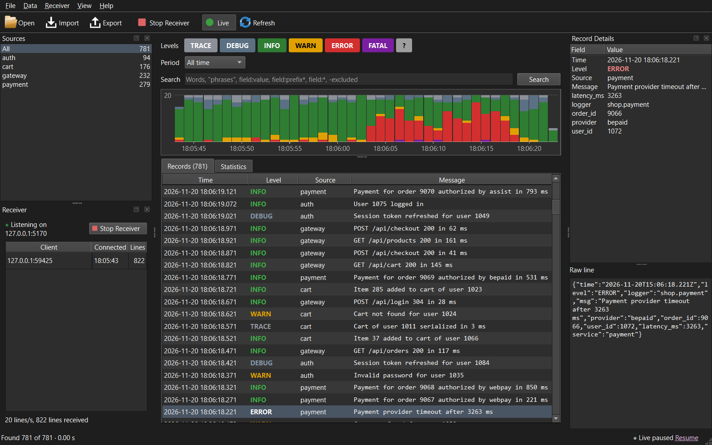

# LogVault

A Windows desktop application that collects logs over TCP and from files, stores them in SQLite and lets you search,
filter and analyze them (C++20, Qt 6 Widgets).



> **Status:** complete (version 1.0.0), a 3rd-year "System Programming" coursework project.
> Design: [docs/DESIGN.md](docs/DESIGN.md) · Progress and handoff notes: [docs/PROGRESS.md](docs/PROGRESS.md)

## Features

- **Databases** — each database is one `*.lvdb` file (SQLite in WAL mode); File → New/Open, the last five databases
  under File → Recent Databases and on the start page.
- **Receiving over TCP** — one record per line, JSON or plain text `<time> <level> <message>`; up to 50 clients at
  once; start/stop, port, "this computer only" or "the whole network", autostart. The Receiver panel shows the
  state, the connected clients and the lines per second.
- **Importing files** — several files at once, from the menu or by dragging them onto the window; in the
  background, with progress and Cancel; multi-line stack traces are kept together.
- **Sources** — created automatically (JSON fields `service`, `source` or `app`, the file name, or the default TCP
  source); record counts; rename; delete with their records.
- **Records table** — time, level in its color, source, message; newest first; columns can be hidden, moved and
  resized. The Record Details panel shows every field and the raw line; any value can be copied or turned into a
  filter with one click.
- **Filters and search** — level buttons (Ctrl+click keeps one level), sources (several at once), period presets
  and a custom range, and a search line:

  | Search line | Finds |
  |---|---|
  | `timeout` | messages containing the word |
  | `"provider timeout"` | messages containing the phrase |
  | `provider:bepaid` | records whose JSON field `provider` is `bepaid` |
  | `order_id:88*`, `user_id:*` | a field value that starts with `88`; any record with the field |
  | `-env:test`, `-debug` | leaves those out |

- **Histogram** of the matches over time, stacked by level; drag across bars to zoom in, Esc to go back.
- **Statistics** — group the matches by level, source, similar messages (digits become `#`) or any JSON field, with
  count and share; a double-click filters by the group.
- **Live mode** — new records appear as they arrive, at most once a second; it waits while you read older records.
- **Export** of every match to CSV (opens in Excel) or JSON Lines, in the background.
- **Deleting** a source or the records older than a date, in the background, with progress and Cancel.
- **Settings** — receiver port and address, default source, autostart, local time or UTC, system/light/dark theme,
  rows in the table. The window remembers its size, panels, histogram height and columns.

## How it works

```
Python logging ──TCP──▶ TcpServer ──lines──▶ Ingestor ──batches of 500 (one transaction)──▶ SQLite (WAL)
log files ──────────▶ FileImporter (thread pool) ───transactions of 1,000──────────────────▶   │
                                                                                               ▼
  MainWindow ◀── results ── SearchService (thread pool, own connection): rows, histogram, statistics
```

The receiver and the batch writer share the intake thread; imports, searches, exports and deletions run in a thread
pool, each job with a database connection of its own, so the window never waits for the disk. Every filter
becomes SQL with bound parameters. Details and the reasons for each decision are in [docs/DESIGN.md](docs/DESIGN.md).

## Building

### Prerequisites

Windows 10/11 with [MSYS2](https://www.msys2.org) installed in `C:\msys64`. In the *MSYS2 UCRT64* shell, install the
compiler, CMake, Ninja and Qt 6 (6.8 or newer):

```bash
pacman -S --needed mingw-w64-ucrt-x86_64-toolchain mingw-w64-ucrt-x86_64-cmake \
    mingw-w64-ucrt-x86_64-ninja mingw-w64-ucrt-x86_64-qt6-base
```

The versions the project is developed with are listed in [docs/PROGRESS.md](docs/PROGRESS.md).

### CLion

One-time setup: *Settings → Build, Execution, Deployment → Toolchains → + → MinGW*, toolset `C:\msys64\ucrt64`,
then move it to the top of the list to make it the default.

CLion shows the `debug` and `release` presets from `CMakePresets.json` as CMake profiles
(*Settings → Build, Execution, Deployment → CMake*; enable `debug` there if it is disabled). Run the `LogVault`
configuration to start the application and `lv_tests` to run the tests.

### Command line

`C:\msys64\ucrt64\bin` must come first in `PATH`. Git Bash:

```bash
export PATH="/c/msys64/ucrt64/bin:$PATH"
cmake --preset debug && cmake --build --preset debug && ctest --preset debug
```

PowerShell:

```powershell
$env:Path = "C:\msys64\ucrt64\bin;$env:Path"
cmake --preset debug
cmake --build --preset debug
ctest --preset debug
```

An optimized build uses the `release` preset: `cmake --preset release`, then `cmake --build --preset release`.
Build files go to `build/<preset>`. The tests (`lv_tests`, Qt Test, about 490 checks) take about 20 seconds.

## Running

The application loads the Qt and compiler DLLs from `C:\msys64\ucrt64\bin` (there is no deployment step), so start
it from CLion or from a shell where that folder is first in `PATH`:

```bash
./build/debug/LogVault.exe
```

Settings, the recent databases and the window layout are kept in `%APPDATA%\LogVault\LogVault.ini`; delete the file
to start with the defaults.

## Sending logs

Any program can send logs: connect to the receiver (default `127.0.0.1:5170`) and write one record per line, JSON
(`{"time": "...", "level": "ERROR", "msg": "...", "service": "payment", ...}`) or plain text
(`2026-11-20 14:05:01.123 ERROR Payment provider timeout`).

[`examples/python_client.py`](examples/python_client.py) (Python 3.8+, standard library only) contains a
`logging.Handler` for Python programs:

```python
import logging
from python_client import LogVaultHandler

logging.getLogger().addHandler(LogVaultHandler("127.0.0.1", 5170))
logging.getLogger("shop.payment").error("Payment provider timeout", extra={"provider": "bepaid"})
```

Run as a script, it produces test traffic:

```bash
python examples/python_client.py --demo                   # an online shop; a burst of errors after 20 s; Ctrl+C stops
python examples/python_client.py --count 10000            # 10,000 numbered lines as fast as possible
python examples/python_client.py --count 200000 --file old.log   # a file to import instead of sending
python examples/python_client.py -h                       # all options (--host, --port, --rate, --duration)
```

## Demo

The scenario from [docs/DESIGN.md](docs/DESIGN.md) §11.1, about seven minutes. Before it, create a file to import:
`python examples/python_client.py --count 200000 --file old.log`.

1. File → New Database… → `demo.lvdb`; Receiver → Start Receiver (Ctrl+R); Live (Ctrl+L).
2. `python examples/python_client.py --demo` — a connection appears in the Receiver panel, records flow in, the
   histogram grows; after 20 seconds the red bars of payment errors appear.
3. Drag across the red bars on the histogram — the period becomes that range; Esc in the histogram goes back.
4. Ctrl+click ERROR; Statistics → Group by: Similar messages — `Payment provider timeout after # ms` is almost all of
   the errors.
5. Double-click `provider` in Record Details → `provider:"bepaid"` in the search line; Statistics → Field… →
   `provider` + Enter shows that one provider is at fault.
6. File → Import Files… → `old.log` — progress in the status bar; its records arrive as a new source, `loadtest`.
7. File → Export Results… (Ctrl+E) → a `.csv` file; open it in Excel.





## Project layout

```
src/core/   storage, parsing, intake, search, export (no widgets; covered by the tests)
src/gui/    the main window, panels, dialogs, settings, theme; resources/ holds the application icon
tests/      Qt Test classes, one executable (lv_tests)
examples/   python_client.py
docs/       DESIGN.md (the design), PROGRESS.md (stages and handoff notes), screenshots/
```

## Known limitations

- Windows only, and it runs from the build folder with MSYS2 in `PATH` (no installer, as agreed for the coursework).
- Two line formats: JSON and plain text `<time> <level> <message>`; other formats (syslog, nginx) are out of scope.
- Times without a zone in the logs are read as the computer's local time.
- CSV cells are written as they are (RFC 4180): a message that starts with `=`, `+`, `-` or `@` may be read by Excel as
  a formula.
- Statistics by similar messages over a million records take about a second (in the background).
